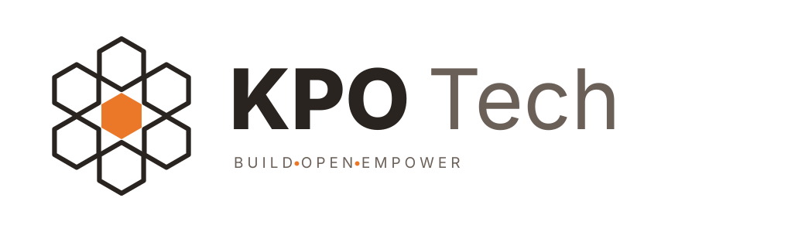

<p align="center">
  <picture>
    <source media="(prefers-color-scheme: dark)" srcset="logo-dark.svg">
    
  </picture>
</p>

<p align="center">
  <b>Agents IA gouvernés, ouverts et déployables chez vous.</b><br>
  <i>Governed, open and self-hostable AI agents.</i>
</p>

<p align="center">
  <a href="https://seshat-ai.com"><b>Site</b></a> ·
  <a href="https://seshat-ai.com/en/docs"><b>Documentation</b></a> ·
  <a href="https://github.com/KPO-Tech/seshat-runtime"><b>Seshat Runtime</b></a> ·
  <a href="mailto:contact@seshat-ai.com"><b>contact@seshat-ai.com</b></a>
</p>

<p align="center">
  
  
  
</p>

---

## Seshat

KPO-Tech builds **Seshat**, an open-source agent runtime written in Go, and the products built on top of it. [Seshat AI](https://seshat-ai.com) is the company around them: AI and automation consulting and integration, for teams that want agents they control.

<p align="center">
  
</p>
<p align="center"><i>One request, five sub-agents working in parallel, in the Seshat terminal interface (film in French).</i></p>

| | Product | What it is | Status |
|---|---|---|---|
| <picture><source media="(prefers-color-scheme: dark)" srcset="assets/runtime-dark.svg"></picture> | **[Seshat Runtime](https://github.com/KPO-Tech/seshat-runtime)** | The engine: Go agent runtime with tools, sandboxed bash, MCP, RAG, 15+ LLM providers, sessions and permissions. Terminal interface, gRPC and Go SDK. Apache-2.0. | **Released**, Linux, macOS and Windows |
| <picture><source media="(prefers-color-scheme: dark)" srcset="assets/os-dark.svg"></picture> | **[SeshatOS](https://github.com/KPO-Tech/SeshatOS)** | Local-first, self-hosted desktop app and backend built on the runtime. Apache-2.0 with the Commons Clause (source-available). | In development |
| <picture><source media="(prefers-color-scheme: dark)" srcset="assets/cloud-dark.svg"></picture> | **SeshatCloud** | Multi-tenant server and console for organizations: team workspaces, scheduled automation that keeps running when your computer is off. Private repository. | In construction |

## Try it in one command

```bash
# Linux and macOS
curl -fsSL https://raw.githubusercontent.com/KPO-Tech/seshat-runtime/main/scripts/install.sh | bash
```

```powershell
# Windows (PowerShell)
irm https://raw.githubusercontent.com/KPO-Tech/seshat-runtime/main/scripts/install.ps1 | iex
```

Then `seshat config --provider anthropic --api-key ...` and run `seshat`. Full guide: [installation](https://seshat-ai.com/en/docs/getting-started/installation).

## Why Seshat

- **Governed execution.** Permissions, sandboxing, audit-friendly sessions and recovery are part of the runtime, not an afterthought.
- **No lock-in.** 15+ providers behind one interface, cloud or local models, your data stays where you put it.
- **One engine, several surfaces.** Terminal interface, gRPC, Go SDK and desktop app all run the same core.
- **A single binary.** No Python environment to babysit to run an agent.

## Work with us

Seshat AI helps teams put agents into real processes, in three steps of increasing commitment:

1. **Assessment**: we look at your processes and tell you what is worth automating, including when a tool already on the market fits better than ours.
2. **Pilot**: one assistant plugged into a real process, with a gain measured in advance and a person who approves anything sensitive.
3. **Operation**: the agents run in production, on your infrastructure when you need it.

Tell us what you want to automate: **[contact@seshat-ai.com](mailto:contact@seshat-ai.com)** · [seshat-ai.com](https://seshat-ai.com)

## Also on GitHub

| Project | What it is |
|---|---|
| [LocalIngest](https://github.com/KPO-Tech/LocalIngest) | CLI and terminal UI that turns a code repository into a Markdown report for documentation or LLM ingestion. |
| [seshat-skills](https://github.com/KPO-Tech/seshat-skills) | Skills for Seshat agents. |

---

<p align="center">
  <sub>Built by <a href="https://github.com/EngineerProjects">Stéphane Kpoviessi</a> · France</sub>
</p>
